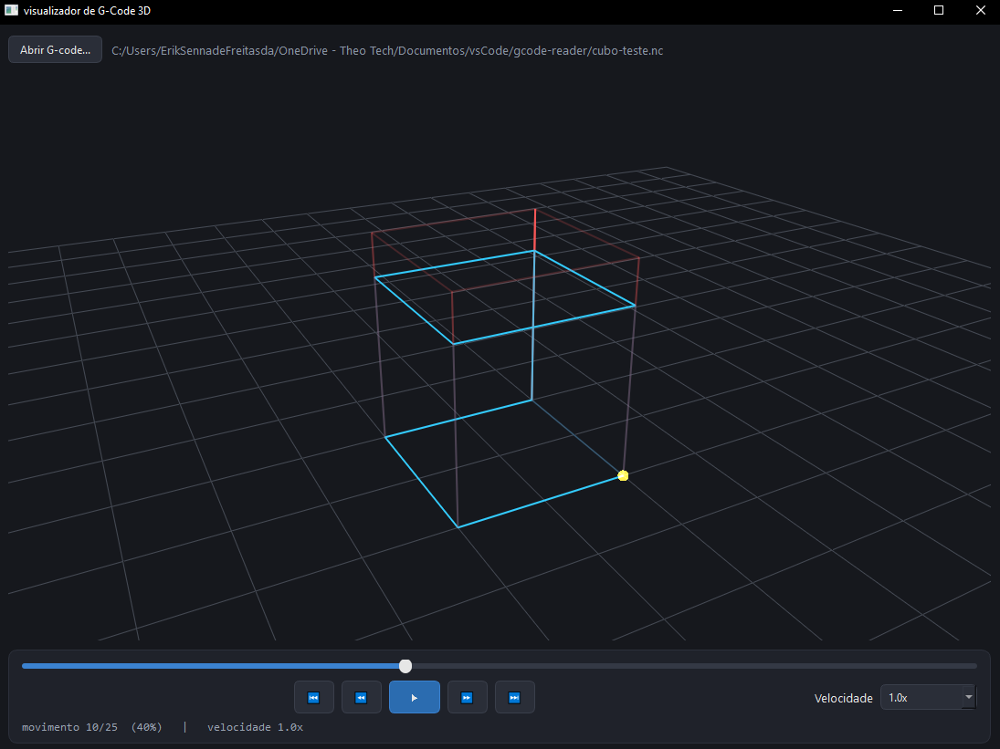

## G-Code Tools

### Sobre

Modernização e acessibilidade em sistemas CNC utilizados para impressão 3D de componentes metálicos: desenvolvimento de ferramenta independente e plugin nativo para o ecossistema mach3.

### Instalação e uso

`git clone https://github.com/eriksnna/g-code-tools`
`cd g-code-tools`

`pip install -r requirements.txt`

Rode o main.py, insira um arquivo G-Code (ou insira o ``cubo-sample.nc``).

### 21/07 — terça-feira ~ 6 horas

- **definição do projeto:** modernização e acessibilidade em sistemas CNC utilizados para impressão 3D de componentes metálicos: desenvolvimento de ferramenta independente e plugin nativo para o ecossistema mach3. o projeto será desenvolvido em duas frentes tecnológicas complementares para otimizar ferramentas de trabalho em manufatura aditiva / impressão 3D.
	
	- **parte 1 -** visualizador independente: desenvolvimento de um aplicativo nativo focado na visualização avançada de G-Code do percurso de impressão 3D, contando com uma interface 2D e 3D altamente intuitiva. o desenvolvimento prevê escalabilidade arquitetural para uma possível ramificação futura voltada à própria geração de instruções G-Code.
	
	- **parte 2 -** integração legada: desenvolvimento de um plugin nativo em C++ injetável no software legado mach3. este módulo permitirá a visualização e teste das trajetórias de corte em tempo real (animações 2D e 3D integradas à memória da máquina), criando a base tecnológica para uma possível renovação completa da interface gráfica (GUI) original do sistema.

### 23/07 — quinta-feira ~ 7 horas

- reunião com cliente | definição de objetivo, escopo e limitações:

o cliente principal e orientador técnico da demanda é o Prof. Dr. Gustavo Henrique, do   **[Manufacturing Technologies Research Laboratory](https://www.dief.unifi.it/vp-207-about.html)** da **Universita degli Studi Firenze** (Itália).

o projeto é destinado diretamente aos alunos, pesquisadores e educadores de universidades por todo o Brasil (e exterior) que dependem do mach3 ou de outras ferramentas CNC para ensino e realização de impressão 3D. atualmente, os softwares de simulação e controle CNC disponíveis no mercado apresentam três grandes barreiras: são datados, possuem licenças pagas de alto custo, ou são de difícil acesso para instituições de ensino e estudantes. o objetivo principal deste projeto é democratizar o acesso à tecnologia de ponta na manufatura, facilitando o uso dessas ferramentas através de interfaces modernas e introduzindo no mercado um novo projeto acessível, seguro e de alto impacto educacional.

### 24/07 — sexta-feira ~ 6 horas

- escolha das ferramentas da parte 1:
	- **para o aplicativo independente (parte 1):** desenvolvimento estruturado em Python, aproveitando a alta eficiência da linguagem para o processamento e parsing de arquivos de texto (G-Code). A interface gráfica de usuário (GUI) e o motor de renderização 3D serão construídos utilizando frameworks robustos do ecossistema Python (como PyQt/PySide para a estruturação nativa das janelas, operando em conjunto com PyOpenGL ou bibliotecas de visualização espacial para a renderização fluida das trajetórias de corte).

### 27/07 — segunda-feira ~ 8 horas

- Teste prático com numpy. **(Sem Parser)**

### 1/08 — sábado / 2/08 — domingo ~ 17 horas

1. Removido o `plot_mock_gcode` e a geração com NumPy da espiral.

2. Adicionado GCodeParser, que:
    - remove comentários (; e ( ... )) e normaliza a linha;
    - extrai pares letra + número (X10.5, G1, F300);
    - mantém o estado modal: modo de movimento (G0/G1/G2/G3), coordenadas absolutas ou incrementais (G90/G91) e unidades (G20 polegadas / G21 mm);
    - converte arcos G2/G3 (centro dado por I/J, plano XY) em pequenos segmentos;
    - separa os movimentos em cortes (G1/G2/G3) e rápidos (G0).

3. Botão agora abre um diálogo para escolher o arquivo.

4. Duas linhas na cena: vermelha translúcida para rápidos, azul para cortes. O modo "lines" desenha cada segmento separadamente.

5. Câmera centralizada no centro da bounding box da peça, com distância proporcional ao tamanho.

6. Limpeza dos itens anteriores antes de cada novo carregamento.

7. Status na tela com a contagem de segmentos e de avisos de parsing.

### 6/08 — quinta-feira ~ 2 horas

- reunião com cliente | definição de objetivos futuros:
	- Trajeto animado
	- Melhoria na interface

### 13/08 — quinta-feira / 14/08, 15/08, 16/08 — domingo ~ 27 horas

1. Atualização no `GCodeParser`. Antes separava cortes e rápidos em duas listas, fazendo com que a ordem se perdesse no processo. Agora guarda uma única lista `moves`, na sequência do arquivo, com a flag `is_cut`.

2. **Animação por cor, não por redesenho.** Em vez de recriar as linhas a cada quadro, o programa desenha o caminho inteiro uma vez, com uma cor por vértice. Os movimentos já executados ficam brilhantes e os restantes ficam apagados. Cada quadro só troca o array de cores, o que mantém a animação fluida mesmo em arquivos grandes. A esfera amarela marca a posição atual da ferramenta.

3. **Controles de mídia.**

- ⏮ e ⏭: vão ao início e ao fim.
- ⏪ e ⏩: retrocedem e avançam 2% do arquivo por clique.
- ▶ / ⏸: reproduzem ou pausam. Ao chegar ao fim, o próximo clique recomeça do zero.
- Timeline: arrastar a barra pausa a reprodução e posiciona o trajeto.
- Velocidade: 0.5x, 1.0x, 1.5x e 2.0x, aplicados em tempo real.

4. **Tempo de reprodução.** A duração a 1.0x é adaptativa: um arquivo com muitos movimentos é reproduzido em cerca de 15 segundos, e um arquivo pequeno usa uma taxa mínima para não ficar lento demais. Isso está em `BASE_DURATION_S` e `MIN_RATE`, caso você queira ajustar.

5. **Interface.** Tema escuro, barra de reprodução destacada, cabeçalho com o nome do arquivo e linha de status com progresso e velocidade atual.

	Limitações

- Todas as linhas usam a mesma espessura. O `GLLinePlotItem` aceita apenas uma largura por item, então os rápidos não aparecem mais finos que os cortes.
- O modo de animação anda por movimentos, não por tempo real de máquina. Um movimento longo e um curto levam o mesmo tempo visual. Se precisar de tempo proporcional à distância ou à velocidade de avanço (`F`), é possível calcular isso no parser com um tempo acumulado por movimento.
	
